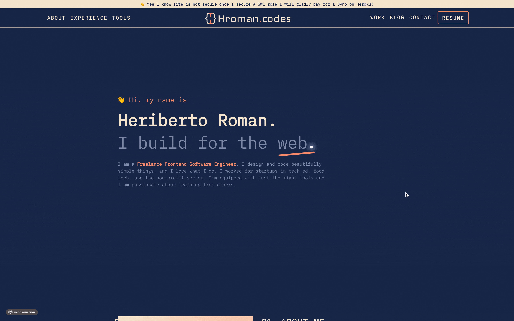

[](https://github.com/heriberto-codes/hrcodes/actions/workflows/fly-deploy.yml)
[](https://wakatime.com/badge/user/3a78d911-a08a-40c2-bf2c-782c4d20eb23/project/1682f28b-b9f7-452f-b0b2-e931f33d3524)



## Live Demo 
[https://heriberto.codes](https://heriberto.codes)

## Process
##### ```Agile Software Development```
- [Trello](https://trello.com/b/yOVitfLV/hromancodes-portfolio-site)

##### ```Design & Prototyping```
- Figma
    - [Logo Design](https://www.figma.com/file/WEta53OsXH1s4ATRhpSkpQ/hroman_Codes?type=design&mode=design&t=2ZuafYJo6gH8xAhF-0)    

## Tech Stack
##### ```Scaffolding```
- HTML
- Django Template Language
##### ```Styling``` 
- CSS
- Bootstrap
##### ```Library```
- Django / Python
- Javascript
##### ```Deployment/Hosting Infrastructure```
- Heroku 
##### ```Animation```
- animate.css

## Turtle AI Workflow

This repository includes [Turtle AI](https://github.com/heriberto-codes/turtle_ai) v1.1.0 as a repo-scoped Codex workflow under `.agents/skills/`.

After opening the repository in Codex, Turtle commands such as `$turtle-plan`, `$turtle-engineer-execute`, and `$turtle-engineer-verify` are discovered automatically. The required implementation loop is:

```text
EXECUTE -> VERIFY -> ENGINEER CHECKPOINT -> TEST -> DEBUG if needed -> PLAN STEP UPDATE
```

Foundation context for this project lives in:

- `agents.md`
- `architecture.md`
- `repo_map.md`

Workflow and state rules live in `docs/system/`. See the [Engineering Workflow guide](docs/guides/planning_workflow.md) for the command sequence.

Installed from Turtle AI commit `04c7a3f732cac0f272eba7c9b031035cfe3eccb0` (branch `main`).

The installation includes all 25 Turtle skills, the four shared workflow documents in `docs/system/`, and the MIT license notice in `docs/licenses/turtle-ai-LICENSE.txt`. Start a fresh Codex chat in this project to discover the updated skills.

In v1.1.0, `$turtle-engineer-commit` creates a commit by default. Use `$turtle-engineer-commit message only` to prepare a message without committing. Git finalization uses separately invoked `$turtle-engineer-add`, `$turtle-engineer-commit`, `$turtle-engineer-push`, and optional `$turtle-engineer-pull-request` skills.

The latest upstream revision retains the v1.1.0 version label and renames 13 engineering skills to `turtle-engineer-*`. Foundation, discovery, design, `$turtle-plan`, and `$turtle-engineer-checkpoint` keep their names. The legacy copies of renamed skills have been removed.
